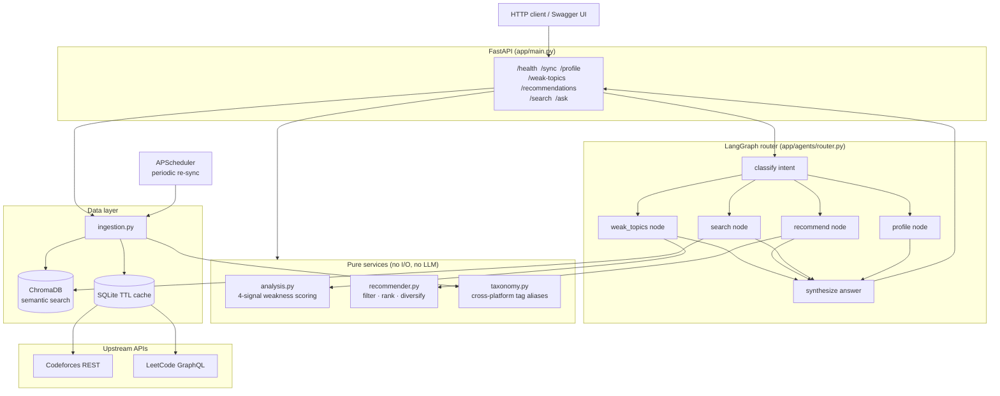

# CP Tutor Agent

A multi-agent AI coach for competitive programming. It reads your **real**
Codeforces and LeetCode history, works out what you are actually weak at, and
recommends real unsolved problems to practise next — answering plain-English
questions like *"what should I practise today"* or *"why am I weak at shortest
paths"*.

The design bias throughout is **explainable over clever**. Weakness is computed
by deterministic arithmetic that decomposes into four named signals with
human-readable reasons attached. The LLM's job is to *route* the question and
*phrase* the answer — never to compute the facts. That split is what makes the
core logic unit-testable and the output reproducible.

```
$ curl -s localhost:8000/weak-topics | jq -r '.topics[0].reasons[]'
6 attempted but unsolved vs 2 solved (75% struggle rate, 18 failed submissions).
Only 2 solved, below the 10-problem target for a topic to count as practised.
Last solved 240 days ago — practice has gone stale.
Hardest solve here is rated 1100, 650 points below your overall best of 1750.
```

---

## Architecture



### How a request flows

1. `POST /sync` fetches submissions from both platforms through a
   retry-and-backoff HTTP client backed by a SQLite TTL cache, normalises tags
   into one taxonomy, and indexes everything into Chroma.
2. `POST /ask` hands the question to a LangGraph `StateGraph`: `classify` →
   one specialist node → `synthesize`. The response carries a `trace` of the
   nodes that ran, so the graph is observable rather than a black box.
3. The specialist nodes call pure service functions. Those functions take a
   list of records and return ranked results — no network, no model, no clock
   except the one you inject.

---

## Quick start

### Locally

```bash
python -m venv .venv && source .venv/bin/activate   # Windows: .venv\Scripts\activate
pip install --extra-index-url https://download.pytorch.org/whl/cpu -r requirements-dev.txt

cp .env.example .env        # fill in CODEFORCES_HANDLE and LEETCODE_USERNAME
uvicorn app.main:app --reload
```

Then open <http://localhost:8000/docs>, run `POST /sync` once, and everything
else has data to work with.

An `ANTHROPIC_API_KEY` is **optional**. Without one the router falls back to a
deterministic keyword classifier and template answers, so tests, CI and offline
demos all still work — they just phrase things more plainly.

### With Docker

```bash
cp .env.example .env
docker compose up --build
open http://localhost:8000/docs
```

Two containers: the stateless API and Chroma in `http` mode, which is how this
would actually be deployed — the index survives an API restart. On a laptop you
can delete the `chroma` service and set `CHROMA_MODE=persistent` instead; that
path is fully supported and needs no extra container.

### Verify

```bash
ruff check . && ruff format --check .
pytest -q                    # 207 tests, no network required
python -m eval.run_eval      # 15/15 behavioural cases
```

---

## API

| Method | Path               | What it does |
|--------|--------------------|--------------|
| GET    | `/health`          | Liveness plus the config that actually affects behaviour |
| POST   | `/sync`            | Pull and index your history (`?force=true` bypasses the cache) |
| GET    | `/profile`         | Aggregate stats across both platforms |
| GET    | `/weak-topics`     | Ranked weaknesses with signals and reasons |
| GET    | `/recommendations` | Real unsolved Codeforces problems to practise |
| GET    | `/search`          | Semantic search over your own history |
| POST   | `/ask`             | Natural-language question, routed through the graph |

Endpoints that need data return **409** with an actionable message until you
have synced. `/search` and `/health` are exempt.

### Examples

**"what should I practise today"**

```bash
curl -s -X POST localhost:8000/ask \
  -H 'content-type: application/json' \
  -d '{"question": "what should I practice today"}'
```

```
Practice these next:
1. Another Shortest Path [1450] (shortest paths) — https://codeforces.com/problemset/problem/900/B
2. Dijkstra Practice [1400] (shortest paths, graphs) — https://codeforces.com/problemset/problem/900/A
3. Graph Traversal Warmup [1400] (graphs) — https://codeforces.com/problemset/problem/910/A
4. Hard DP [1500] (dynamic programming) — https://codeforces.com/problemset/problem/901/A
5. Counting Paths [1550] (math) — https://codeforces.com/problemset/problem/906/A
```

The JSON alongside that prose carries `recommendations[]`, `based_on_topics[]`
and `rating_band`, so a client never has to parse English.

**"what are my weakest topics"**

```
Your weakest topics right now:
1. graphs — score 0.77, 2 solved / 6 unsolved. Only 2 solved, below the 10-problem target for a topic to count as practised.
2. shortest paths — score 0.77, 2 solved / 6 unsolved. Only 2 solved, below the 10-problem target for a topic to count as practised.
3. geometry — score 0.26, 1 solved / 0 unsolved. Only 1 solved, below the 10-problem target for a topic to count as practised.
4. math — score 0.26, 1 solved / 0 unsolved. Only 1 solved, below the 10-problem target for a topic to count as practised.
5. dynamic programming — score 0.22, 10 solved / 0 unsolved. Hardest solve here is rated 900, 850 points below your overall best of 1750.
```

Note the last line: ten DP solves, still ranked a weakness, because every one of
them is 850 rating points below the user's ceiling. Twenty easy DP problems is
not DP competence — that is the `difficulty` signal doing its job.

**"why am I weak at shortest paths"**

```
You rank shortest paths at a weakness score of 0.77 (confidence 0.80). Here is why:
  - Only 2 solved, below the 10-problem target for a topic to count as practised.
  - Last solved 240 days ago — practice has gone stale.
  - Hardest solve here is rated 1100, 650 points below your overall best of 1750.
  - 6 attempted but unsolved vs 2 solved (75% struggle rate, 18 failed submissions).
```

**"how many problems have I solved"**

```
You have solved 25 problems across 6 topics (6 attempted but unsolved).
Your hardest solve is rated 1750, average 1204.2.
```

---

## The weakness score

Every topic is scored on four normalised signals, blended by weights that live
in configuration so the ranking can be retuned without a code change:

| Signal       | Meaning                                                        | Weight |
|--------------|----------------------------------------------------------------|--------|
| `coverage`   | How far below a healthy solve count the topic sits             | 0.35   |
| `staleness`  | Days since the last solve — skills decay                       | 0.25   |
| `difficulty` | How far the topic's hardest solve trails your overall ceiling   | 0.20   |
| `struggle`   | Share of touched problems attempted and never solved           | 0.20   |

The blend is then damped by a **confidence** term derived from sample size, so a
topic with two data points cannot outrank one with thirty. Topics you have
never touched are injected from the Codeforces problemset's tag frequency, so
genuine blind spots surface — filtered by `MIN_TOPIC_FREQUENCY` so an obscure
tag on four problems is not ranked as urgently as never having written a DP.

Reasons are ordered by **weighted contribution** (`weight × signal`), not by raw
signal value. A saturated `staleness` at 0.25 weight moved the score less than a
0.8 `coverage` at 0.35 weight, so quoting staleness first would misdirect the
reader. The first reason you see is always the one that actually drove the rank.

---

## Design decisions

### Deterministic scoring, not "ask the LLM what I'm bad at"

Three reasons, and this is the decision the rest of the project is built around:

- **Reproducibility.** The same history must always yield the same ranking. A
  model asked to eyeball a thousand submissions will not do that, and a coaching
  tool that changes its mind between refreshes is not trustworthy.
- **Testability.** These are pure functions over a list of records, so the suite
  pins each signal independently. You cannot unit-test a vibe.
- **Explainability.** Every score decomposes into four named signals with the
  arithmetic attached. When the tutor says "you are weak at shortest paths", it
  can show its work.

This paid off concretely: the first full test run surfaced three real bugs —
mis-ordered explanations, a recommendation list that was not monotonically
best-first, and a regex that could never match the plural "problems". None of
those are findable by eyeballing LLM output.

### Failed submissions are kept, not filtered out

Most trackers keep `verdict == "OK"` and throw the rest away. Attempted-and-never-solved
is the sharpest weakness signal available — a 75% struggle rate on shortest
paths says far more than a solve count — so failures are first-class data here.
Failed problems also stay *eligible* for recommendation; they are prime practice
material, not spent.

### LangGraph over a plain chain

A linear chain would work for one intent. This has five (`weak_topics`,
`recommend`, `search`, `profile`, `general`) that need different data and
different synthesis, and the graph gives three things a chain does not: explicit
conditional routing, typed state that each node contributes to, and a `trace` of
visited nodes returned to the caller. The last one matters most in practice —
when a question routes to the wrong specialist you can see it in the response
instead of guessing.

Intent classification uses Claude structured output, with a **deterministic
keyword classifier as fallback** when no API key is present. Same graph, same
nodes, no credentials — which is exactly what CI runs.

### Chroma for semantic search

The useful query is *"show me problems like the graph ones I struggled with"*,
which keyword matching cannot serve: a search for "graph traversal" should
surface problems tagged `dfs and similar` and `trees` even though those words
never appear. Documents embed `name + normalised tags + source + difficulty`;
metadata keeps rating, timestamp and URL for filtering.

Chroma specifically because it runs embedded with zero infrastructure for local
use *and* as a service for the compose stack — same client code, one config
flag. Embeddings are local `all-MiniLM-L6-v2`, so there is no per-query cost and
no data leaving the machine. `chromadb` is imported lazily so unit tests do not
pay for it.

### A tag taxonomy, because the platforms disagree

Codeforces says `dp`, LeetCode says `Dynamic Programming`. Without normalisation
the analysis silently splits one skill into two half-populated topics and both
look like weaknesses. `taxonomy.py` maps both onto canonical names — a pure
function, and one of the easiest parts of the system to test.

### The LeetCode public-API limitation

LeetCode's public GraphQL only exposes your **~20 most recent accepted
submissions**. There is no public full-history endpoint. This project handles it
explicitly rather than pretending otherwise:

- By default it uses the public queries (`matchedUser.submitStatsGlobal`,
  `recentAcSubmissionList`, `question(titleSlug)`) and you get recent history
  plus accurate per-difficulty totals.
- Set `LEETCODE_SESSION` to your browser cookie and the client switches to the
  authenticated `problemsetQuestionList(filters: {status: AC})` query and pages
  your *full* solved list.

The client picks the path automatically and **logs which one it used**;
`/health` reports `leetcode_full_history` so you always know which mode you are
in. Codeforces has no such limitation — `user.status` returns everything.

### Two TTLs, not one

User submissions get one hour; the Codeforces problemset gets twenty-four. The
problemset is a ~1.5 MB payload that only changes when a contest is added, so
re-fetching it hourly is pure waste. Cache keys are a sha256 of method + URL +
sorted params, and the retry policy backs off on 429/5xx/timeouts but never
retries a 4xx — retrying a bad handle just burns rate limit.

### Recommendations you can actually attempt

Filter the live problemset → drop what you have solved → keep problems tagged
with your weak topics → keep the rating inside a band around your current rating
(default −100 to +300: practice should be uncomfortable, not impossible) → rank
by weakness × rating proximity × popularity → cap per topic so a session stays
varied instead of ten near-identical DP problems.

The per-topic cap decides *membership*; a final sort decides *presentation*, so
the list is still strictly best-first after diversification.

---

## Testing

```
pytest -q                 # 207 tests, zero network calls
python -m eval.run_eval   # 15 end-to-end behavioural cases
```

The unit suite mocks httpx at the transport layer with `respx`, so client
parsing is tested against real response shapes without a network. Parsing is
isolated in pure `parse_*` functions for exactly this reason.

The eval harness is a **behavioural gate** on top of that: 15 natural-language
questions run through the real graph over fixture data, each asserting the
correct intent, the required fields, and five universal invariants — including
*never recommend a problem the user has already solved* and a per-request
latency budget. It exits non-zero, so CI fails on a behavioural regression that
the unit tests would happily pass.

Fixtures use timestamps relative to *now* rather than a hardcoded date, so the
staleness signal keeps testing what it is meant to test instead of drifting
toward "everything is stale" as the repo ages.

## CI

Every push and PR runs lint, format check, the network-free test suite and the
eval harness on Python 3.11 and 3.12, plus a Docker build that **boots the
image and curls `/health`** — because a successful build does not prove the app
starts. Both the CI job and the Dockerfile install torch from the PyTorch CPU
wheel index, which keeps ~2 GB of CUDA libraries out of an environment that will
never see a GPU.

## Configuration

Every tunable — handles, keys, TTLs, retry counts, scoring weights, rating
bands — is a typed field on a single `Settings` object read from the
environment. See [`.env.example`](.env.example) for the annotated list. Nothing
is hardcoded at a call site and no secret is ever committed.

## License

MIT — see [LICENSE](LICENSE).
